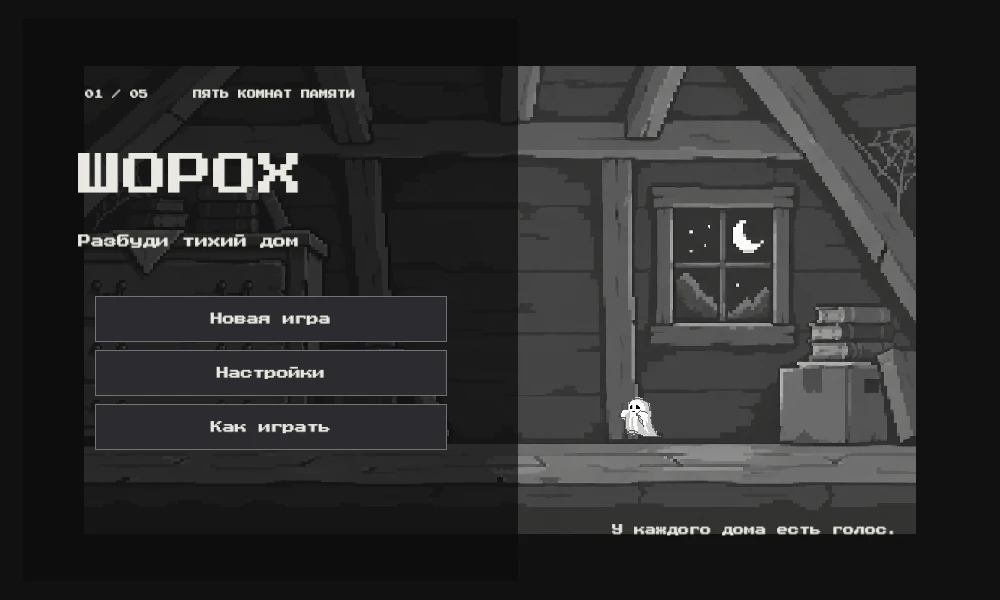
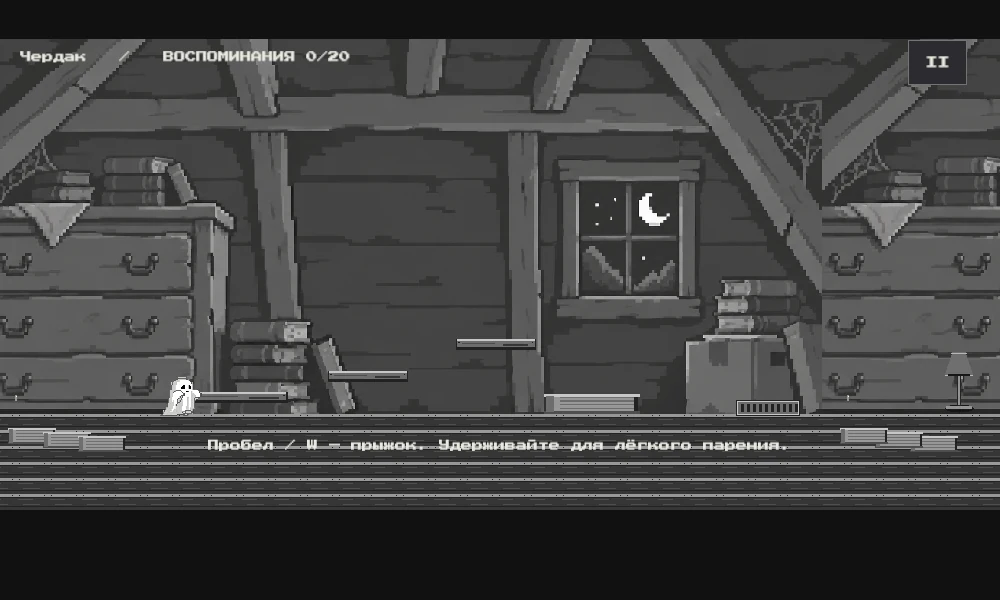

# Шорох / Shorok

Монохромный 2D-платформер с головоломками. Маленькое привидение просыпается на чердаке и пытается оживить притихший дом. Вселяйтесь в предметы, чтобы использовать их способности и добраться до часового зала.

- Пять комнат, шесть предметов со способностями и 20 воспоминаний для дополнительной финальной сцены.
- Unity 6.3 LTS, C# и WebGL. Есть управление с клавиатуры и сенсорными кнопками.

## Запуск

1. Откройте корень репозитория в Unity Hub с редактором `6000.3.24f1`.
2. Откройте сцену `Assets/Game/Scenes/Bootstrap.unity` и нажмите **Play**.

Для WebGL-сборки установите модуль Web Build Support и выберите **Tools → Shorok → Build → Yandex Release**.

Подробности по сборке и устройству проекта есть в [руководстве](Documentation/PROJECT_GUIDE.md).

Тесты проекта доступны в Unity Test Runner на вкладках **Edit Mode** и **Play Mode**. Команда `node Tools/check-platform.cjs` проверяет JavaScript-мост для Яндекс Игр.

## Управление

- **A / D** или стрелки — движение, **Пробел / W / ↑** — прыжок.
- **E** — вселиться в предмет или выйти, **F** — применить способность, **Q** — развернуть вентилятор.
- **Esc** — пауза, удерживайте **R**, чтобы начать комнату заново.

## Скриншоты

